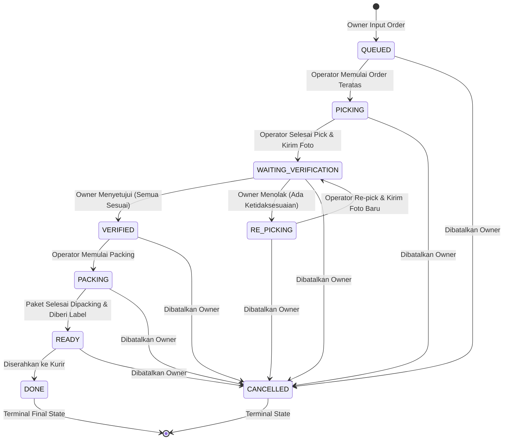

# PRD — PERSONAL STOCK & ORDER FULFILLMENT MANAGER

---

## 1. Product Overview

### 1.1 Nama Produk

**Personal Stock & Order Fulfillment Manager** (sebelumnya _Personal Stock Manager_, diintegrasikan dengan modul _Koordinasi Order Toko / Order Rumah_).

### 1.2 Platform & Teknologi

- **Mobile Client:** Flutter (Android & iOS)
- **State Management:** Provider
- **Backend & Database:** Supabase (PostgreSQL, Supabase Auth, Supabase Storage, Supabase Realtime)
- **Push Notification:** Firebase Cloud Messaging (FCM)
- **Architecture Principle:**
  - `PostgreSQL / RPC` → Source of Truth & Atomic Mutator
  - `Supabase Realtime` → Signal Perubahan State Antar-Device
  - `Provider` → Local State Management di Client
  - `FCM` → Background Push Notification saat aplikasi idle/ditutup

### 1.3 Latar Belakang & Masalah

Aplikasi awal dikembangkan sebagai _Personal Stock Manager_ untuk memantau, mencatat, dan mengontrol stok barang secara real-time dari beberapa perangkat. Namun dalam operasional harian toko online / marketplace:

1. **Owner Berada di Luar Rumah:** Owner mengelola penjualan marketplace saat sedang bepergian atau bekerja di luar.
2. **Barang & Stok Berada di Rumah:** Fisik barang berada di tempat tinggal / gudang rumah bersama anggota keluarga/tim operasional (**Operator**).
3. **Kendala Fulfillment:** Operator di rumah tidak terbiasa dengan dashboard marketplace yang rumit, tidak tahu SKU mana yang harus diambil, letak rak penyimpanan barang, atau bentuk varian fisiknya.
4. **Resiko Kesalahan Pengiriman:** Barang salah ambil (varian/ukuran/warna salah), quantity kurang, atau order dibatalkan pembeli saat operator sedang mengambil barang.
5. **Kebutuhan Kontrol Owner:** Owner tetap memerlukan hak kendali penuh untuk verifikasi visual (foto barang yang diambil) sebelum pesanan dipacking dan diserahkan ke kurir, tanpa kehilangan histori mutasi stok.

### 1.4 Tujuan Aplikasi

Menggabungkan keandalan **Manajemen Stok Pribadi** (yang sudah terdevelop) dengan **Sistem Koordinasi Order Fulfillment Marketplace** (dari `new-prd.md`):

1. **Kelola Produk & Lokasi:** Menyimpan data produk, SKU, varian, harga, stok terkini, foto produk, dan lokasi fisik penyimpanan (contoh: _Rak A1, Kotak B3_).
2. **Kontrol Mutasi Stok:** Catat stok masuk, stok keluar (terjual, rusak, hilang, dsb.), serta stok opname dengan jaminan konsistensi atomic (database transaction / RPC).
3. **Scan QR / Barcode:** Pencarian cepat dan input data produk via kamera.
4. **Input Order Marketplace & SKU Matching:** Input order cepat (manual / paste teks pesanan) dan pencocokan otomatis terhadap katalog produk.
5. **Antrean Order FIFO (Single-Active Task):** Operator di rumah fokus mengerjakan pesanan satu per satu tanpa distraksi atau tumpang tindih.
6. **Panduan Picking Terstruktur:** Operator dipandu item-demi-item dengan visual foto, detail varian, dan lokasi rak.
7. **Verifikasi Foto oleh Owner:** Operator mengunggah foto barang hasil picking, Owner memverifikasi dari jarak jauh (Setuju / Minta Re-pick untuk item tertentu).
8. **Packing & Serah Terima Kurir:** Tahapan jelas hingga pesanan berstatus `DONE`.
9. **Realtime Multi-Device Sync & Push Notifications:** Notifikasi seketika antar-device saat ada order baru, perubahan order, atau verifikasi.

---

## 2. User Roles & Workspace Model

Aplikasi menggunakan model multi-user berbasis peran (**Role-Based Access Control**) di bawah satu Workspace Owner:

```text
               ┌───────────────────────────────┐
               │         OWNER ACCOUNT         │
               │  (Decision Maker & Stok Admin) │
               └───────────────┬───────────────┘
                               │
               ┌───────────────┴───────────────┐
               │       OPERATOR ACCOUNT(S)     │
               │   (Fulfillment Executor Rumah)│
               │     owner_id = Owner.id       │
               └───────────────────────────────┘
```

### 2.1 Role: OWNER

- Pemilik toko dan pemegang keputusan tertinggi (_Decision Maker_).
- Memiliki kontrol penuh atas katalog produk, kategori, satuan, dan saldo stok.
- Menginput pesanan baru dari marketplace ke aplikasi.
- Memiliki hak mengedit, merevisi item, dan membatalkan pesanan kapan saja sebelum pesanan berstatus `DONE`.
- Menerima foto hasil picking operator dan memverifikasi kesesuaian barang.
- Melihat dashboard analitik stok, nilai inventaris, dan histori pesanan.

### 2.2 Role: OPERATOR

- Anggota pelaksana di rumah / gudang (_Executor_).
- Menjalankan antrean pesanan aktif yang ditugaskan secara berurutan (FIFO).
- Mengikuti panduan visual aplikasi: mencari barang berdasarkan foto, nama varian, dan lokasi fisik rak.
- Menandai item yang telah diambil (_picking / partial picking_), melaporkan stok fisik yang bermasalah.
- Mengunggah foto hasil picking untuk verifikasi Owner.
- Melakukan re-pick jika ada instruksi koreksi dari Owner.
- Melakukan packing paket dan mengonfirmasi serah terima ke kurir.
- **Batasan Operator:** Operator **tidak dapat** membatalkan pesanan, mengubah jumlah item pesanan secara sepihak, atau mengedit harga/katalog produk.

### 2.3 Row Level Security (RLS) & Workspace Isolation

- Setiap entitas data (`products`, `categories`, `orders`, `order_items`, `stock_transactions`, dll.) terikat pada `user_id` (yaitu ID milik Owner).
- Akun Operator memiliki field `owner_id` yang merujuk pada profil Owner.
- Melalui fungsi `is_workspace_member(owner_id)` dan `is_workspace_owner()`, Supabase RLS memastikan Operator hanya dapat membaca katalog & order milik Owner-nya, dan hanya dapat mengupdate status picking/packing yang diizinkan.

---

## 3. Technology Stack

### 3.1 Mobile Frontend (Flutter)

- **Framework:** Flutter SDK (Dart)
- **State Management:** Provider
- **Networking & API:** Supabase Flutter SDK & Dio / HTTP Client
- **Camera & Scanning:** Mobile Scanner / QR Code Scanner package & Image Picker
- **Local Cache & Storage:** Shared Preferences / Secure Storage untuk token & preferensi offline

### 3.2 Backend & Cloud (Supabase)

- **Authentication:** Supabase Auth (Email & Password)
- **Database:** PostgreSQL dengan Row Level Security (RLS)
- **Mutations & Business Logic:** PostgreSQL Functions / Stored Procedures (RPC) dengan transactional locks (`SELECT FOR UPDATE`)
- **File Storage:** Supabase Storage (Bucket: `product-images` dan `verification-photos`)
- **Realtime Engine:** Supabase Realtime (Channels & Postgres Changes)

### 3.3 Notifications (Firebase Cloud Messaging)

- **FCM Push Notification:** Mengirimkan pesan background / lockscreen ke perangkat Owner dan Operator saat ada event penting (misal: "Order Baru Masuk", "Menunggu Verifikasi Foto", "Order Dibatalkan").
- **Device Registry:** Tabel `user_devices` menyimpan token FCM dan jenis platform perangkat.

---

## 4. Product Catalog & Master Data

### 4.1 Master Units (Satuan) & Categories

- **Units:** Satuan kuantitas barang (contoh: `Pcs`, `Box`, `Pack`, `Lusin`, `Kg`).
- **Categories:** Pengelompokan jenis produk (contoh: `Pakaian Pria`, `Aksesoris`, `Elektronik`, `Makanan`). Kategori yang sedang digunakan oleh produk tidak boleh dihapus (_restrict delete_).

### 4.2 Product Entity Fields

| Field                       | Tipe Data | Wajib    | Deskripsi                                             |
| --------------------------- | --------- | -------- | ----------------------------------------------------- |
| `id`                        | UUID      | System   | Primary Key                                           |
| `user_id`                   | UUID      | System   | ID Owner pemilik produk                               |
| `category_id`               | UUID      | Yes      | Referensi ke tabel `categories`                       |
| `unit_id`                   | UUID      | Yes      | Referensi ke tabel `units`                            |
| `name`                      | Text      | Yes      | Nama produk                                           |
| `sku`                       | Text      | Optional | Kode SKU unik per workspace user                      |
| `description`               | Text      | Optional | Deskripsi / catatan khusus produk                     |
| `image_url`                 | Text      | Optional | URL foto produk (Supabase Storage)                    |
| `location`                  | Text      | Optional | Lokasi fisik penyimpanan (contoh: _Rak A1, Box Biru_) |
| `purchase_price`            | Numeric   | Yes      | Harga beli produk (HPP / modal)                       |
| `recommended_selling_price` | Numeric   | Yes      | Rekomendasi harga jual toko                           |
| `minimum_stock`             | Integer   | No       | Batas stok minimum (pemicu alert low stock)           |
| `current_stock`             | Integer   | System   | Stok fisik saat ini (dimutasi via ledger/RPC)         |
| `is_active`                 | Boolean   | System   | Status aktif produk (soft delete flag)                |
| `created_at` / `updated_at` | Timestamp | System   | Waktu pembuatan & update                              |

### 4.3 Aturan SKU & QR / Barcode

- SKU bersifat unik per Owner.
- SKU dapat diinput manual atau dipindai langsung melalui kamera menggunakan QR/Barcode Scanner.
- QR/Barcode pada produk membawa isi teks berupa SKU produk.
- Produk tanpa SKU tetap dapat digunakan dan dicari melalui nama pada katalog.
- Foto produk dan lokasi penyimpanan fisik menjadi referensi utama bagi Operator saat proses picking order marketplace.

---

## 5. Core Inventory Management (Fitur Terdevelop)

Semua fungsionalitas manajemen stok yang sudah ada tetap dipertahankan secara utuh dan menjadi fondasi utama inventaris.

### 5.1 Integritas Stok & Ledger Transaksi

- Nilai `current_stock` pada tabel `products` **tidak boleh di-update langsung dari client Flutter**.
- Setiap penambahan, pengurangan, atau penyesuaian stok wajib melalui PostgreSQL RPC secara atomic.
- Setiap mutasi menghasilkan baris baru pada tabel `stock_transactions` dan audit pada `product_logs`.

### 5.2 Stok Masuk (Stock In)

- Digunakan saat restock barang dari supplier atau penambahan stok awal.
- **Input:** Produk, Jumlah (Qty > 0), Harga Beli, Tanggal/Waktu, Catatan.
- **Dampak:** `current_stock = current_stock + Qty`, mencatat `stock_transactions` tipe `IN` dengan `adjustment = +Qty`.

### 5.3 Stok Keluar (Stock Out)

- Digunakan saat barang keluar di luar jalur marketplace otomatis (contoh: penjualan offline, barang rusak, barang hilang, pemakaian pribadi).
- **Input:** Produk, Jumlah (Qty > 0), Alasan (_Terjual, Rusak, Hilang, Dipakai Pribadi, Lainnya_), Catatan.
- **Aturan Validasi:** Qty stok keluar tidak boleh melebihi `current_stock`. Jika stok tidak cukup, transaksi ditolak oleh RPC dengan pesan error: `Stok tidak mencukupi. Tersedia: X, Diminta: Y`.
- **Dampak:** `current_stock = current_stock - Qty`, mencatat `stock_transactions` tipe `OUT` dengan `adjustment = -Qty`.

### 5.4 Stok Opname (Stock Adjustment)

- Digunakan untuk mencocokkan stok sistem dengan stok fisik hasil perhitungan berkala di gudang rumah.
- **Input:** Produk, Stok Fisik Aktual, Catatan.
- **Kalkulasi Sistem:**
  $$\text{Selisih (Difference)} = \text{Stok Fisik} - \text{Stok Sistem}$$
- **Dampak:** `current_stock` disesuaikan menjadi nilai Stok Fisik Aktual, mencatat record di tabel `stock_opnames`, serta mencatat transaksi bertipe `ADJUSTMENT` di `stock_transactions`.

### 5.5 Riwayat Transaksi & Filter

- Daftar transaksi ditampilkan kronologis dari yang terbaru (_descending_).
- Filter transaksi berdasarkan tipe: _Semua, Stok Masuk, Stok Keluar, Opname_.
- Setiap entri menampilkan perubahan stok (sebelum vs sesudah), adjustment (+/-), alasan, tanggal, dan nama produk.

### 5.6 Dashboard Stok & Nilai Persediaan

- **Total Produk:** Jumlah produk aktif yang terdaftar.
- **Total Item:** Total kuantitas seluruh fisik barang ($\sum \text{current\_stock}$).
- **Nilai Persediaan:** Estimasi nilai aset gudang ($\sum \text{current\_stock} \times \text{purchase\_price}$).
- **Low Stock Indicator:** Daftar barang dengan kondisi $\text{current\_stock} \le \text{minimum\_stock}$ agar Owner segera melakukan restock.
- **Quick Actions:** Akses cepat ke Scan QR, Stok Masuk, Stok Keluar, Stok Opname, dan Tambah Order.

---

## 6. Order Fulfillment Management (Fitur Baru)

Modul ini mengoordinasikan proses pemenuhan pesanan marketplace antara Owner di luar rumah dan Operator di rumah.

### 6.1 Input Order & SKU Matching

1. **Sumber Pesanan:** Pesanan berasal dari platform marketplace (Shopee, Tokopedia, TikTok Shop, Lazada, dsb.).
2. **Metode Input oleh Owner:**
   - Input manual form pesanan.
   - Fitur _Quick Paste_: Owner menempelkan teks rincian pesanan dari aplikasi marketplace.
3. **Pencocokan SKU (SKU Matching):**
   - Sistem membaca baris pesanan dan mencocokkan SKU terhadap katalog `products`.
   - Jika semua SKU cocok: Status order siap dimasukkan ke antrean (_3/3 item dikenali_).
   - Jika ada SKU yang tidak dikenali: Sistem memberi peringatan (_1 item tidak dikenali_), Owner diminta melakukan mapping ke produk katalog atau menambahkan produk baru sebelum order dapat diproses.
4. **Item Snapshotting (`order_items`):**
   - Saat order dibuat, sistem membuat snapshot data produk: `sku_snapshot`, `name_snapshot`, `variant_snapshot`, `location_snapshot`, dan `photo_snapshot`.
   - Hal ini memastikan jika katalog produk diedit di kemudian hari, rincian pesanan historis tidak berubah.

### 6.2 Antrean Pesanan (Order Queue - Strict FIFO)

- Pesanan menggunakan antrean **First-In First-Out (FIFO)** berdasarkan waktu input ke aplikasi.
- **Prinsip Single-Active Order:** Hanya ada **1 order aktif** yang dikerjakan oleh Operator pada satu waktu.
- Order berikutnya berstatus `QUEUED` dan baru dapat dimulai setelah order sebelumnya berstatus `DONE` atau `CANCELLED`.
- Tujuannya agar Operator di rumah tidak bingung atau mencampuradukkan barang dari beberapa pesanan berbeda.

### 6.3 Siklus Status Pesanan (Order Lifecycle & State Machine)



| Status                 | Penjelasan                                                                   | Aktor Utama          |
| ---------------------- | ---------------------------------------------------------------------------- | -------------------- |
| `QUEUED`               | Pesanan berada dalam antrean tunggu FIFO                                     | Sistem               |
| `PICKING`              | Operator sedang mengambil barang satu per satu di gudang rumah               | Operator             |
| `WAITING_VERIFICATION` | Operator telah selesai mengambil seluruh item dan mengunggah foto bukti      | Owner (Review)       |
| `RE_PICKING`           | Owner mendeteksi kesalahan; Operator mengambil ulang item yang bermasalah    | Operator             |
| `VERIFIED`             | Owner mengonfirmasi seluruh item dan foto sudah sesuai                       | Operator (Instruksi) |
| `PACKING`              | Operator sedang mengemas paket (bubble wrap, dus, lakban)                    | Operator             |
| `READY`                | Paket sudah rapi dan siap menunggu penjemputan/pengantaran kurir             | Operator / Kurir     |
| `DONE`                 | Paket telah diserahkan ke kurir ekspedisi (status final, tidak dapat diubah) | Sistem / Operator    |
| `CANCELLED`            | Pesanan dibatalkan oleh Owner sebelum berstatus `DONE`                       | Owner                |

---

## 7. Operator Workflow & Quality Control

### 7.1 Alur Pengambilan Barang (Picking Step-by-Step)

1. Operator membuka aplikasi dan langsung melihat kartu pesanan aktif paling atas.
2. Operator menekan **Mulai Ambil Barang** (`PICKING`).
3. Aplikasi menyajikan daftar barang secara teratur. Untuk setiap item ditampilkan:
   - Nomor urut item (misal: _Barang 1 dari 3_).
   - SKU produk.
   - Nama produk & Varian (Warna/Ukuran).
   - Foto referensi produk.
   - Lokasi fisik penyimpanan (_Contoh: Rak A2, Laci 3_).
   - Kuantitas yang diminta (`quantity_required`).
4. **Partial Picking:**
   - Jika barang yang diminta ada 3 pcs, tetapi operator baru menemukan 2 pcs, operator dapat mencatat kuantitas parsial (`quantity_picked = 2`, status `PARTIAL`).
   - Operator dapat melanjutkan pencarian sisa barang tanpa harus mengulang dari awal.
5. Tombol konfirmasi per item: **Sudah Diambil** (`PICKED`).

### 7.2 Verifikasi Foto & Persetujuan Owner

1. **Pengambilan Foto:** Setelah seluruh item selesai dipick, Operator meletakkan seluruh barang secara rapi dan mengambil 1 foto jelas yang mencakup seluruh item pesanan.
2. Foto diunggah ke Supabase Storage (`verification-photos`) dan order beralih ke `WAITING_VERIFICATION`.
3. **Pemberitahuan ke Owner:** Perangkat Owner menerima sinyal Realtime dan notifikasi FCM: _"Order #123 siap diverifikasi"_.
4. **Antarmuka Verifikasi Owner:**
   - Owner melihat preview foto resolusi tinggi (bisa di-zoom).
   - Owner mencocokkan foto dengan daftar checklist item & kuantitas pesanan.
5. **Keputusan Verifikasi:**
   - **Semua Sesuai (`MATCH`):** Status berubah menjadi `VERIFIED`. Aplikasi Operator menampilkan instruksi: _"Verifikasi berhasil! Silakan packing pesanan"_.
   - **Ada Yang Tidak Sesuai (`MISMATCH` / `DAMAGED`):**
     - Owner menandai item mana yang salah dan memilih alasannya sesuai enum `verification_reason` di database:
       - `WRONG_ITEM` (Salah produk atau salah varian/ukuran)
       - `MISSING_QUANTITY` (Kuantitas kurang atau barang belum lengkap)
       - `DAMAGED_ITEM` (Fisik barang cacat / rusak)
       - `OTHER` (Lainnya / Catatan khusus diisi pada kolom `note`)
     - Order beralih ke `RE_PICKING`.
   - **Foto Tidak Jelas (Foto Blur / Gelap / Tertutup):**
     - Jika barang sebenarnya benar namun foto tidak dapat diverifikasi, Owner dapat meminta **Foto Ulang**. Operator cukup memotret kembali tanpa perlu re-pick.

### 7.3 Targeted Re-Picking

- Dalam status `RE_PICKING`, Operator **hanya diminta mengambil ulang item yang ditandai salah oleh Owner**.
- Item yang sudah benar tetap berstatus `PICKED` dan tidak perlu dicari ulang.
- Setelah item yang salah dikoreksi, Operator mengambil foto baru dan mengirimkan ulang untuk verifikasi.

### 7.4 Packing & Serah Terima Kurir

1. **Packing:** Operator membungkus barang sesuai standar keamanan packing toko. Status order berubah ke `PACKING`.
2. **Ready for Courier:** Setelah paket selesai ditempel resi / label, Operator menekan tombol **Paket Siap** (`READY`).
3. **Courier Handover:** Saat kurir datang mengambil paket, Operator menekan **Sudah Diserahkan ke Kurir**.
4. Status pesanan berubah menjadi `DONE` dengan mencatat waktu selesai (`completed_at`). Pesanan selesai dan antrean berikutnya otomatis naik menjadi order aktif.

---

## 8. Dynamic Order Modification & Cancellation

Owner memegang kendali penuh sebagai _Decision Maker_ di setiap tahapan sebelum pesanan berstatus `DONE`.

### 8.1 Perubahan Order saat Proses Berjalan (Edit On-the-Fly)

Jika pembeli di marketplace mengubah pesanannya atau meminta penggantian varian saat Operator sedang bekerja:

1. **Saat Status `PICKING`:**
   - Jika kuantitas bertambah: Operator cukup mengambil kekurangannya.
   - Jika item dihapus: Aplikasi memberi tahu Operator untuk mengembalikan item tersebut ke rak.
   - Jika ada item baru: Item baru muncul di daftar picking.
2. **Saat Status `VERIFIED` atau `PACKING`:**
   - Jika pesanan diubah oleh Owner, status otomatis dikembalikan ke `PICKING` untuk item yang terdampak.
   - Verifikasi sebelumnya dibatalkan untuk item tersebut agar tidak terjadi salah kirim.
3. **Saat Status `READY`:**
   - Jika paket belum diserahkan ke kurir, Owner tetap dapat merevisi. Paket dibuka kembali dan disesuaikan dengan instruksi baru.

### 8.2 Pembatalan Order (Cancellation)

- Owner dapat membatalkan pesanan kapan saja sebelum `DONE`.
- Ketika Owner menekan **Batalkan Order**, sistem langsung mengupdate status menjadi `CANCELLED`.
- Perangkat Operator seketika menampilkan popup peringatan dengan suara/getar:
  > **Order #XXX Dibatalkan!**  
  > _Jangan lanjutkan proses pesanan ini. Silakan kembalikan barang ke rak penyimpanan._
- Order yang dibatalkan tidak lagi menghalangi antrean FIFO. Pesanan berikutnya dapat langsung dikerjakan.

---

## 9. Integrasi Order Fulfillment dengan Stok Inventaris

Agar sistem stok dan pesanan selaras tanpa membuat operasional terhambat:

```text
Order Marketplace Masuk (QUEUED)
        ↓
    Picking & Verifikasi Fisik
        ↓
    Packing & Paket Siap (READY)
        ↓
    Serah Terima Kurir (DONE)
        ↓
  [ Trigger / RPC Otomatis ]
  Potong Stok (Stock Out)
  - Type: OUT
  - Reason: Terjual (Marketplace)
  - Quantity: Sesuai Item Order
  - Atomic Ledger Transaction
```

1. **Pemotongan Stok Otomatis saat `DONE`:**
   - Ketika status pesanan mencapai `DONE`, PostgreSQL trigger / RPC secara otomatis membuat transaksi `stock_transactions` bertipe `OUT` dengan alasan `Terjual (Order #XXX)` untuk setiap item yang terdaftar.
   - Nilai `current_stock` pada produk berkurang secara otomatis dan atomic.
2. **Pencegahan Double Deduction:**
   - Jika pesanan dibatalkan (`CANCELLED`), tidak ada pemotongan stok yang terjadi.
   - Jika ada item yang rusak saat picking (`DAMAGED_ITEM`), Operator/Owner dapat mencatatnya melalui menu _Stok Keluar (Rusak)_ terpisah untuk menjaga akurasi pembukuan stok fisik.

---

## 10. Concurrency, Versioning & Audit Trail

### 10.1 Optimistic Concurrency Control (`version`)

- Setiap baris di tabel `orders` memiliki kolom integer `version` (default = 1).
- Setiap kali Owner mengedit pesanan atau mengubah status, `version` dinaikkan secara inkremental (`version = version + 1`).
- Ketika Operator mengirimkan aksi picking, client mengirimkan version yang sedang dipegang. Jika version di server lebih tinggi (karena Owner baru saja mengedit pesanan saat Operator offline/lemot), request ditolak dan client Operator dipaksa melakukan _refresh state terbaru_.
- Ini mencegah race condition di mana aksi Operator menimpa instruksi revisi dari Owner.

### 10.2 Audit Trail (`order_events`)

Setiap mutasi bisnis pada order dicatat dalam tabel `order_events`:

| Event Type            | Keterangan                           | Aktor    |
| --------------------- | ------------------------------------ | -------- |
| `ORDER_CREATED`       | Pesanan baru diinput ke antrean      | Owner    |
| `ORDER_UPDATED`       | Pesanan diedit (item, varian, qty)   | Owner    |
| `ORDER_CANCELLED`     | Pesanan dibatalkan                   | Owner    |
| `PICKING_STARTED`     | Operator mulai mengambil barang      | Operator |
| `ITEM_PICKED`         | Operator menandai item sudah diambil | Operator |
| `PHOTO_SUBMITTED`     | Foto picking diunggah                | Operator |
| `VERIFICATION_PASSED` | Owner menyetujui hasil picking       | Owner    |
| `VERIFICATION_FAILED` | Owner menolak / meminta re-pick item | Owner    |
| `PACKING_STARTED`     | Operator mulai membungkus paket      | Operator |
| `READY_FOR_COURIER`   | Paket siap diambil kurir             | Operator |
| `HANDED_TO_COURIER`   | Paket diserahkan ke kurir (`DONE`)   | Operator |

### 10.3 Log Perubahan Produk (`product_logs`)

Mencatat aksi `CREATE`, `UPDATE`, `DELETE`, `STOCK_IN`, dan `STOCK_OUT` pada katalog produk beserta `old_data` dan `new_data` dalam format JSONB.

---

## 11. Push Notifications & Offline Resilience

### 11.1 Notifikasi Cepat via Realtime & FCM

- **Saat Aplikasi Terbuka (Foreground):** Supabase Realtime langsung memperbarui UI seketika tanpa perlu refresh manual.
- **Saat Aplikasi Tertutup (Background / Terminated):** Firebase Cloud Messaging (FCM) mengirimkan notifikasi push prioritas tinggi.

**Skenario Notifikasi:**

- **Ke Operator:**
  - _"Pesanan Baru Tersedia di Antrean (#SPX-001)"_
  - _"Perhatian: Order #SPX-001 telah DIBATALKAN oleh Owner!"_
  - _"Order #SPX-001 Diperbarui: Ada perubahan item barang."_
  - _"Hasil Verifikasi: Silakan lanjut Packing!"_
  - _"Hasil Verifikasi Ditolak: Mohon cek item yang perlu di-repick."_
- **Ke Owner:**
  - _"Order #SPX-001 Menunggu Verifikasi Foto dari Operator."_
  - _"Order #SPX-001 Selesai: Telah diserahkan ke Kurir."_

### 11.2 Penanganan Kondisi Offline & Reconnection

- Operator tetap dapat melihat data pesanan yang terakhir berhasil diunduh saat koneksi terputus.
- Aksi picking yang dilakukan saat offline disimpan secara lokal dan akan disinkronkan (_flushed_) saat koneksi kembali stabil.
- Jika sebelum sinkronisasi ternyata pesanan telah dibatalkan atau diubah oleh Owner, aturan server (_Server Source of Truth_) selalu menang, dan Operator diberikan notifikasi penyesuaian.

---

## 12. UI Architecture & Navigation

Aplikasi menyesuaikan navigasi antarmuka berdasarkan peran akun yang sedang login.

```text
                           LOGIN SCREEN
                                ↓
                   Periksa Role di Profiles
                   ├── Role: OWNER ───→ OWNER MAIN NAVIGATION
                   └── Role: OPERATOR ─→ OPERATOR MAIN NAVIGATION
```

### 12.1 Navigasi Utama: OWNER

Bottom Navigation Bar dengan 5 Tab:

1. **Dashboard:** Ringkasan nilai stok, item low stock, status antrean order aktif, dan tombol aksi cepat (_Scan QR, Input Order, Stok Masuk/Keluar_).
2. **Katalog Produk:** Daftar produk lengkap, filter kategori, pencarian, status stok, tombol tambah/edit produk, dan detail lokasi rak.
3. **Orders (Pesanan):** Tab Antrean Pesanan (`QUEUED`, `PICKING`, `WAITING_VERIFICATION`, `PACKING`, `READY`), riwayat pesanan selesai (`DONE`), dan tombol **+ Input Order**.
4. **Histori Stok:** Riwayat mutasi masuk, keluar, dan stok opname.
5. **Pengaturan:** Profil toko, manajemen kategori, manajemen satuan, daftar perangkat terhubung, dan Logout.

### 12.2 Navigasi Utama: OPERATOR

Navigasi yang disederhanakan agar fokus penuh pada eksekusi lapangan:

1. **Tugas Aktif (Home / Active Order):** Tampilan layar penuh pesanan aktif yang sedang dikerjakan (Daftar picking, foto referensi, lokasi rak, upload foto bukti, packing & kurir). Jika tidak ada order aktif, menampilkan kartu antrean berikutnya yang siap diambil.
2. **Antrean (Queue):** Melihat daftar pesanan berikutnya yang sedang mengantre (hanya ringkasan nomor order dan jumlah item, read-only).
3. **Notifikasi:** Daftar pesan dan instruksi dari Owner.
4. **Profil:** Info akun Operator dan Logout.

---

## 13. Daftar Layar (Screen Specifications)

### Layar Umum & Autentikasi

- **Screen 1 — Splash:** Validasi token sesi Supabase, cek role user di tabel `profiles`, dan routing ke dashboard yang sesuai.
- **Screen 2 — Login:** Form Email & Password. Tidak menyediakan registrasi publik mandiri (akun dibuat terkelola).

### Layar Inventaris & Produk (Owner)

- **Screen 3 — Dashboard Owner:** Kartu metrik stok (Total Produk, Total Item, Nilai Persediaan), indikator stok rendah, banner order aktif butuh verifikasi, tombol quick scan.
- **Screen 4 — Products List:** Pencarian produk real-time, filter kategori, badge kuantitas stok, status aktif/non-aktif.
- **Screen 5 — Product Detail:** Rincian lengkap produk (SKU, nama, foto, lokasi rak, harga modal, harga jual, stok minimum, stok saat ini), histori transaksi produk, dan tombol aksi stok.
- **Screen 6 — Add / Edit Product:** Form nama, SKU (dengan tombol kamera scan), kategori, satuan, lokasi rak (_Text_), upload foto produk ke Supabase Storage, harga beli, rekomendasi harga jual, dan stok minimum.
- **Screen 7 — QR / Barcode Scanner:** Tampilan kamera pemindai SKU dengan autofocus dan flash toggle. Mendukung auto-open detail produk atau quick stock transaction.
- **Screen 8 — Stock In:** Form penambahan stok (Pilih produk, input Qty, harga beli, tanggal, catatan).
- **Screen 9 — Stock Out:** Form pengurangan stok (Pilih produk, input Qty, pilih alasan: _Terjual, Rusak, Hilang, Dipakai Pribadi, Lainnya_, catatan). Validasi stok cukup.
- **Screen 10 — Stock Opname:** Form pencocokan stok fisik vs sistem dengan kalkulasi otomatis selisih (+/-).
- **Screen 11 — Stock Transaction History:** Daftar log mutasi stok lengkap dengan chip filter tipe transaksi (_Semua, Masuk, Keluar, Opname_).
- **Screen 12 — Transaction Detail:** Rincian satu transaksi stok (stok sebelum vs sesudah, user pembuat, waktu, catatan).
- **Screen 13 — Categories & Units Management:** CRUD kategori dan satuan produk.
- **Screen 14 — Settings & Store Profile:** Pengaturan nama toko, alamat, kontak, daftar sesi device, tombol ganti password, dan logout.

### Layar Order Fulfillment (Owner & Operator)

- **Screen 15 — Order List & Queue:** Tampilan tab antrean pesanan (`Aktif`, `Selesai`, `Dibatalkan`) dengan indikator badge status berwarna jelas.
- **Screen 16 — Add Order (Owner):** Form input order baru, input manual / paste teks marketplace, deteksi SKU otomatis, mapping SKU jika ada yang baru, dan simpan ke antrean.
- **Screen 17 — Order Detail & Verification (Owner):**
  - Melihat rincian order, nomor pesanan, marketplace, dan waktu input.
  - Saat status `WAITING_VERIFICATION`: Tampilan viewer foto hasil picking operator (bisa zoom/pan), checklist kesesuaian item, tombol **Semua Sesuai (Approve)** dan **Ada Masalah (Reject/Re-pick)** dengan modal pemilihan alasan salah item.
  - Tombol aksi: Edit Order, Batalkan Order.
- **Screen 18 — Operator Active Picking Screen (Operator):**
  - Tampilan item-by-item: nomor item, foto produk, SKU, varian, kuantitas yang harus diambil, lokasi rak.
  - Tombol **Sudah Diambil**, input kuantitas parsial jika barang kurang, tombol **Laporkan Masalah**.
  - Progress bar picking (_Contoh: 2/3 Barang Selesai_).
- **Screen 19 — Operator Photo Upload Screen (Operator):**
  - Tampilan setelah seluruh item berhasil dipick.
  - Tombol ambil foto via kamera, preview foto, dan tombol **Kirim Foto ke Owner**.
- **Screen 20 — Operator Packing & Courier Screen (Operator):**
  - Saat `VERIFIED`: Instruksi packing paket. Tombol **Selesai Packing**.
  - Saat `READY`: Informasi paket menunggu kurir. Tombol **Serahkan ke Kurir**.
- **Screen 21 — Order Event Log:** Riwayat lengkap jejak audit pesanan (waktu order dibuat, mulai pick, upload foto, verifikasi, dsb.).
- **Screen 22 — Notification Center:** Daftar notifikasi masuk yang belum dibaca (_unread_) dan sudah dibaca.

---

## 14. Main User Flows

### Flow 1: Manajemen Produk & Stok Masuk

```text
Owner Buka Tab Produk → Tekan (+) Tambah Produk
  ↓
Isi Nama, Lokasi Rak (contoh: Rak B2), Ambil Foto Produk, Scan Barcode/SKU, Satuan & Kategori
  ↓
Simpan Produk ke Database Supabase
  ↓
Buka Menu Stok Masuk → Pilih Produk → Masukkan Qty 50 pcs → Simpan
  ↓
Stok Terupdate via RPC (Current Stock = 50, Catat Ledger Transaksi)
```

### Flow 2: Siklus Lengkap Order Fulfillment Marketplace

```text
[OWNER] Input Order dari Marketplace (#SPX-101)
  ↓ SKU Matching Berhasil (2 Item Dikenali)
Order Masuk Antrean (Status: QUEUED, Posisi 1)
  ↓ Realtime Signal / FCM ke Operator
[OPERATOR] Membuka Aplikasi → Menekan "Mulai Ambil Barang" (Status: PICKING)
  ↓
Operator Mendatangi Rak A1 (Melihat Foto & Varian di Layar) → Ambil 2 pcs Baju Biru L → Tekan "Sudah Diambil"
Operator Mendatangi Rak B2 → Ambil 1 pcs Celana Hitam M → Tekan "Sudah Diambil"
  ↓ Seluruh Barang Terkumpul
Operator Memotret Seluruh Barang Bersama Resi → Tekan "Kirim Foto untuk Verifikasi" (Status: WAITING_VERIFICATION)
  ↓ Realtime Signal / FCM ke Owner
[OWNER] Membuka Notifikasi di Luar Rumah → Review Foto & Checklist Barang
  ↓ Foto & Item Sesuai → Tekan "SEMUA SESUAI" (Status: VERIFIED)
[OPERATOR] Menerima Notifikasi "Silakan Packing" → Membungkus Paket Rapi → Tekan "Selesai Packing" (Status: READY)
  ↓ Kurir Ekspedisi Datang
[OPERATOR] Menyerahkan Paket ke Kurir → Tekan "Sudah Diserahkan ke Kurir" (Status: DONE)
  ↓ Trigger Database Otomatis
Stok Produk Otomatis Berkurang (Stock Out: Terjual) & Order Tertutup Final
```

### Flow 3: Penanganan Verifikasi Mismatch (Re-Picking)

```text
[OWNER] Saat Review Foto: Melihat varian celana yang diambil adalah Ukuran S (seharusnya Ukuran M)
  ↓
Owner Menekan "Ada Yang Tidak Sesuai"
  ↓ Memilih Item: Celana Hitam → Alasan: WRONG_ITEM → Catatan: "Tolong ganti ukuran M, di foto terlihat S"
Status Order Berubah menjadi RE_PICKING
  ↓ Realtime Signal / FCM ke Operator
[OPERATOR] Melihat Layar Re-pick:
  - Baju Biru L (Tetap Aman / Centang Hijau)
  - Celana Hitam (Perlu Diganti: "Ambil ukuran M di Rak B2")
  ↓
Operator Menukar Barang Fisik → Mengambil Foto Ulang → Kirim Verifikasi
  ↓
[OWNER] Review Foto Baru → Sesuai → "SEMUA SESUAI" (Status: VERIFIED)
```

### Flow 4: Edit Order Dinamis di Tengah Proses Picking

```text
Owner Mendapat Chat Pembeli Marketplace: Minta tambah 1 pcs barang
  ↓
Owner Menekan "Edit Order" pada Order #SPX-101 → Tambah 1 pcs Kaos Kaki di Rak C1
  ↓ Server Menaikkan version = version + 1
Layar Operator Otomatis Terupdate (Realtime)
  ↓
Aplikasi Operator Menampilkan Notifikasi: "Order diperbarui: Ada penambahan 1 item baru"
  ↓
Operator Melanjutkan Picking untuk Item Tambahan tersebut tanpa Mengulang Item Sebelumnya
```

---

## 15. Error Handling & Edge Cases

| Kasus Masalah                                 | Dampak Sistem                                    | Solusi & Penanganan                                                                                                                                             |
| --------------------------------------------- | ------------------------------------------------ | --------------------------------------------------------------------------------------------------------------------------------------------------------------- |
| **Koneksi Internet Terputus saat Picking**    | Operator offline di gudang                       | Data terakhir tetap dapat dilihat di layar. Aksi picking disimpan di antrean lokal; sinkronisasi otomatis saat terhubung kembali.                               |
| **Konflik Versi (Stale Version)**             | Owner mengedit order saat Operator sedang submit | Server menolak payload dengan version lama (`HTTP 409 Conflict`). Client mengambil data terbaru dari server dan mengabari Operator perubahan yang terjadi.      |
| **Stok Fisik Tidak Ditemukan**                | Barang di rak kosong / hilang                    | Operator menekan tombol "Barang Tidak Ditemukan" pada item tersebut. Owner menerima alert untuk memutuskan: ganti produk, kurangi order, atau batalkan pesanan. |
| **Foto Bukti Buram / Gelap**                  | Owner tidak bisa memeriksa keaslian barang       | Owner menekan opsi "Minta Foto Ulang" tanpa mengubah status picking item. Operator cukup mengambil foto baru di tempat terang.                                  |
| **Stok Inventaris Kurang saat Order Selesai** | Stok sistem di bawah 0                           | Sistem memberikan peringatan peringatan darurat ke Owner, mencatat stok minus dengan audit log, dan menginstruksikan opname segera.                             |
| **Duplikasi SKU pada Produk Baru**            | Kegagalan integritas data                        | Validasi client dan constraint database unik `(user_id, sku)` menolak input dengan pesan _"SKU sudah digunakan oleh produk lain"_.                              |

---

## 16. Database Schema Alignment

Arsitektur database mengacu penuh pada implementasi di `database-schema.md`:

```text
auth.users
    │
    ▼
profiles (id, name, role [OWNER/OPERATOR], owner_id)
    │
    ├── store_settings (id, user_id, store_name, address, phone_number, header_footer_note)
    ├── categories (id, user_id, name)
    ├── units (id, name, description)
    ├── products (id, user_id, category_id, unit_id, name, sku, image_url, location, purchase_price, ...)
    │     ├── stock_transactions (id, user_id, product_id, type [IN/OUT/ADJUSTMENT], quantity, adjustment, ...)
    │     ├── stock_opnames (id, user_id, product_id, system_stock, physical_stock, difference, ...)
    │     └── product_logs (id, user_id, product_id, action, old_data, new_data, ...)
    │
    ├── orders (id, user_id, order_number, marketplace, status, version, queue_position, ...)
    │     ├── order_items (id, user_id, order_id, product_id, sku_snapshot, location_snapshot, photo_snapshot, ...)
    │     │     └── order_item_pickings (id, user_id, order_item_id, quantity_picked, status [PENDING/PARTIAL/PICKED])
    │     ├── order_verifications (id, user_id, order_id, attempt_number, photo_url, result, verified_by)
    │     │     └── order_verification_items (id, user_id, verification_id, order_item_id, reason, note)
    │     └── order_events (id, user_id, order_id, event_type, actor_id, metadata)
    │
    ├── notifications (id, user_id, order_id, type, title, body, is_read)
    └── user_devices (id, user_id, fcm_token, platform, last_seen_at)
```

### 16.1 Pemetaan Custom Types & Enums Database

Semua status dan tipe di PRD wajib menggunakan nilai enum persis seperti di `database-schema.md`:

1. **`user_role`:** `'OWNER'`, `'OPERATOR'`
2. **`stock_transaction_type`:** `'IN'`, `'OUT'`, `'ADJUSTMENT'` (Transaksi stok opname tersimpan sebagai `'ADJUSTMENT'`).
3. **`picking_status`:** `'PENDING'`, `'PARTIAL'`, `'PICKED'`
4. **`verification_result`:** `'MATCH'`, `'MISMATCH'`, `'DAMAGED'`
5. **`verification_reason`:** `'WRONG_ITEM'`, `'MISSING_QUANTITY'`, `'DAMAGED_ITEM'`, `'OTHER'`
6. **`product_logs.action`:** `'CREATE'`, `'UPDATE'`, `'DELETE'`, `'STOCK_IN'`, `'STOCK_OUT'`

### 16.2 Catatan Rekomendasi Migrasi DDL (Schema Gap)

- **Kolom `location` pada `public.products`:**  
  Pada tabel `order_items`, kolom `location_snapshot text not null` mensyaratkan lokasi fisik rak saat pesanan dibuat. Namun pada definisi tabel `products` di `database-schema.md`, kolom `location` belum tersedia. Oleh karena itu, skema database memerlukan migrasi:
  ```sql
  alter table public.products add column if not exists location text;
  ```
- **Integrasi Stok saat Order Selesai:**  
  Saat order mencapai status `DONE`, PostgreSQL Function / RPC memotong stok produk secara otomatis dan mencatat baris baru pada `stock_transactions` (tipe `OUT`, alasan `Terjual`).

---

## 17. Scope & Non-Goals MVP

### 17.1 In-Scope (Fitur Target Utama)

- Autentikasi Supabase & Manajemen Peran (Owner vs Operator dalam satu workspace).
- Manajemen Katalog Produk lengkap dengan Foto Produk, Lokasi Rak Penyimpanan, Satuan, dan SKU unik.
- Scanner QR/Barcode via kamera untuk pencarian cepat dan inventarisasi produk.
- Mutasi Stok Dasar: Stok Masuk, Stok Keluar dengan berbagai alasan, dan Stok Opname (atomic RPC).
- Riwayat transaksi stok lengkap dan indikator stok menipis (_Low Stock Alert_).
- Input Order Marketplace & SKU Matching otomatis.
- Antrean Pesanan FIFO dengan prinsip _Single-Active Task_.
- Panduan Picking untuk Operator dengan visual foto produk dan lokasi rak.
- Alur Verifikasi Foto oleh Owner (Approve / Reject dengan alasan spesifik per item).
- Alur Re-picking terarah (hanya item yang salah).
- Modifikasi & Pembatalan Order fleksibel oleh Owner sebelum status `DONE`.
- Packing & Konfirmasi Serah Terima Kurir (`DONE`).
- Integrasi pemotongan stok otomatis saat pesanan selesai.
- Realtime state sync antar-device & Push Notification via Firebase Cloud Messaging (FCM).

### 17.2 Out of Scope untuk Fase Ini (Non-Goals)

- Integrasi langsung API Marketplace (Shopee Open API, Tokopedia API auto-scrape).
- Integrasi langsung API Ekspedisi / Cetak Label Pengiriman Thermal Printer otomatis.
- Sistem POS kasir toko fisik dan modul pembayaran online / payment gateway.
- Pembukuan akuntansi rumit (laba-rugi komprehensif, neraca, pajak).
- Multi-warehouse bertingkat (hanya mendukung 1 gudang / rumah per workspace Owner).
- Manajemen Batch/Lot Number, Serial Number per unit, dan Expiry Date otomatis.
- Fitur in-app chat internal (komunikasi menggunakan notifikasi terstruktur dan catatan order).

---

## 18. Success Criteria (Kriteria Keberhasilan)

Aplikasi dianggap berhasil dan siap operasional harian apabila:

1. **Keandalan Stok:** Data `current_stock` selalu sinkron dengan histori mutasi `stock_transactions` tanpa deviasi data (atomic transaction teruji).
2. **Koordinasi Jarak Jauh Berjalan:** Owner di luar rumah berhasil memasukkan order, Operator di rumah mendapatkan instruksi picking yang jelas berdasarkan foto dan letak rak.
3. **Akurasi Pengiriman Meningkat:** Verifikasi foto oleh Owner berhasil mencegah pengiriman barang yang salah varian atau salah jumlah sebelum barang dibungkus.
4. **Respon Cepat Terhadap Perubahan:** Pembatalan atau revisi order oleh Owner seketika menghentikan proses picking operator di lapangan tanpa ada barang yang salah terkirim.
5. **Multi-Device & Notifikasi Realtime:** Update status order dan stok berpindah antar perangkat dalam waktu < 2 detik via Supabase Realtime, dan notifikasi FCM diterima saat perangkat terkunci.
6. **Data Terisolasi Aman:** Operator tidak memiliki akses untuk mengubah katalog, menghapus stok, atau melihat data milik workspace lain (RLS lolos audit keamanan).

---

## 19. Development Priority & Implementation Roadmap

```text
┌────────────────────────────────────────────────────────────────────────┐
│ FASE 1: Core Inventory & Product Management (TERDEVELOP)               │
│ - Supabase Auth, PostgreSQL schema, RLS dasar                          │
│ - Category, Unit, Product CRUD, Location & Image URL support           │
│ - QR/Barcode Scanner, SKU search                                       │
│ - Stock In, Stock Out, Stock Opname (PostgreSQL RPC)                   │
│ - Transaction History, Low Stock Dashboard                             │
└──────────────────────────────────┬─────────────────────────────────────┘
                                   │
                                   ▼
┌────────────────────────────────────────────────────────────────────────┐
│ FASE 2: User Roles & Order Management Foundation                       │
│ - Setup Profile Roles (OWNER & OPERATOR) dan Workspace RLS             │
│ - Integrasi Supabase Storage untuk Foto Produk & Bukti Verifikasi      │
│ - Order Input Form (Manual & Quick Paste) + SKU Matching Engine        │
│ - Order Queue Management (FIFO) & Dynamic Order Editing / Cancellation │
└──────────────────────────────────┬─────────────────────────────────────┘
                                   │
                                   ▼
┌────────────────────────────────────────────────────────────────────────┐
│ FASE 3: Operator Picking & Photo Verification Flow                     │
│ - Antarmuka Operator: Single-Active Picking Screen (Item, Foto, Rak)  │
│ - Modul Pengambilan Foto Bukti Picking & Upload ke Storage             │
│ - Antarmuka Owner: Viewer Verifikasi Foto (Approval & Reject Reason)   │
│ - Targeted Re-picking Loop & Retake Foto                               │
└──────────────────────────────────┬─────────────────────────────────────┘
                                   │
                                   ▼
┌────────────────────────────────────────────────────────────────────────┐
│ FASE 4: Packing, Handover & Stock Integration                          │
│ - Status Packing & Courier Handover (Status READY → DONE)              │
│ - Database RPC: Auto Stock Deduction saat Order berstatus DONE         │
│ - Order Versioning (Optimistic Concurrency Control)                    │
│ - Order Events Audit Log                                               │
└──────────────────────────────────┬─────────────────────────────────────┘
                                   │
                                   ▼
┌────────────────────────────────────────────────────────────────────────┐
│ FASE 5: Realtime Sync, FCM Notifications & Polish                      │
│ - Supabase Realtime Channel untuk sinkronisasi state instan            │
│ - Setup Firebase Cloud Messaging (FCM) & tabel user_devices            │
│ - Penanganan Offline / Reconnection & Stale Version Handling           │
│ - UI/UX Refinement, Loading & Empty States, Testing Skenario Lengkap  │
└────────────────────────────────────────────────────────────────────────┘
```
